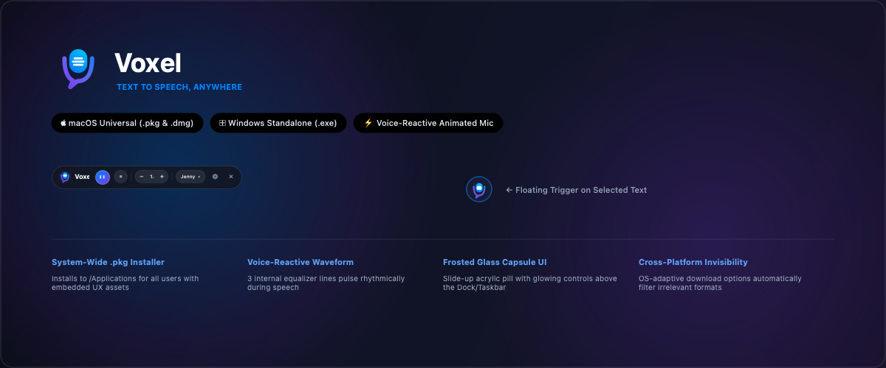
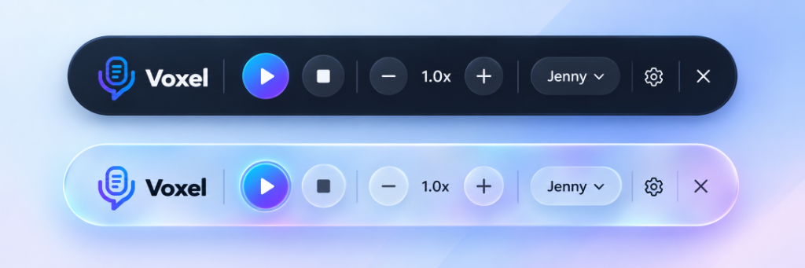
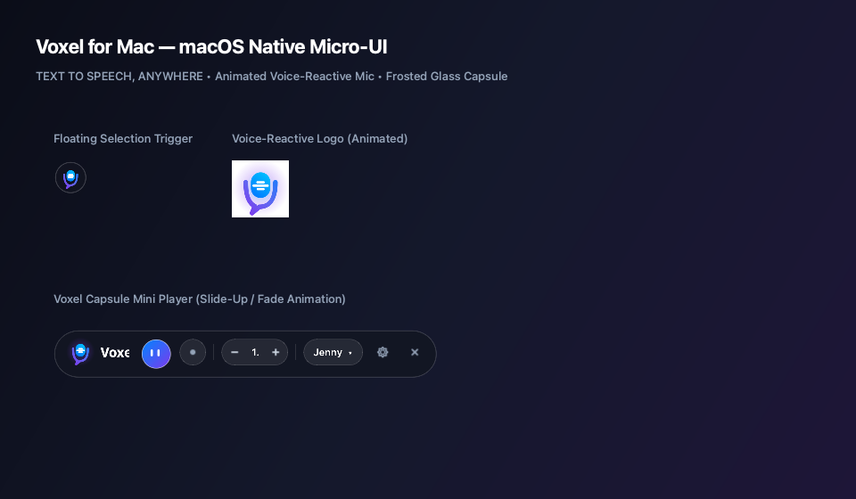

<!-- README.md (v1.3) - [2026-11-01] -->
# Voxel — Text to Speech, Anywhere

<p align="center">
  
</p>

<p align="center">
  <a href="https://github.com/Digimo2020/Voxel-/releases"></a>
  <a href="LICENSE"></a>
  <a href="https://github.com/Digimo2020/Voxel-"></a>
  <a href="https://github.com/Digimo2020/Voxel-/releases/latest"></a>
</p>

---

## 🎙 What is Voxel?

**Voxel** is an open-source, frosted glass desktop text-to-speech utility created as an official **Digimo Product** ([digimo.pt](https://www.digimo.pt/)) for reading highlighted text aloud anywhere on **macOS** and **Windows**. 

Featuring the official **Voxel purple & cyan brand emblem**, dynamic voice-reactive waveform equalizer animations, a subtle floating selection trigger, and an animated bottom-right capsule player, Voxel blends seamlessly into your workflow across any document, web browser, PDF, or text editor.

---

## ✨ Key Features & UX Design

- 🌊 **Voice-Reactive Waveform Animation**: The 3 internal lines of the microphone capsule pulse and dance at 40 FPS like a real-time audio equalizer during playback, accented by a soft breathing radial glow.
- 🫧 **Non-Intrusive Floating Trigger**: Appears smoothly with fade-in easing near your cursor whenever you highlight text, without stealing window focus (`WA_ShowWithoutActivating`).
- 💊 **Frosted Glass Capsule Player**: Slides up above your Dock/Taskbar with smooth cubic easing. Includes a glowing electric blue-to-violet play/pause button, delicate stop button, segmented speed regulator (`[-] 1.0x [+]`), and voice switcher.
- 💿 **macOS DMG Installer**: A simple drag-and-drop disk image that places `Voxel.app` in the Applications folder with official native `.icns` branding.
- 👁️ **Platform-Adaptive Downloads**: Download options automatically adapt to the user's operating system, showing the relevant macOS or Windows build.
- 🗣️ **High-Definition Neural Voices**: Microsoft Edge Neural TTS voices (Jenny, Guy, Sonia, Aria) with instant offline fallback to native macOS Speech (`Samantha`, `Alex`) or Windows SAPI5.
- ⚡ **Zero-Dependency Audio Engine**: Modernized with `PyQt6.QtMultimedia` for hardware-accelerated CoreAudio playback without SDL or external C dependencies.
- 🛡️ **macOS Accessibility Assistant**: Proactive permissions checker with 1-click shortcut to macOS Privacy & Security settings.

---

## 🎨 Official Branding & Logo Architecture

Voxel features an authentic, custom-designed visual identity built with rich purple, vibrant cyan, and pure white accents. All source brand assets are organized in `assets/Fainal/` and automatically compiled into production-grade transparent PNG, macOS `.icns`, and Windows `.ico` formats.

### 1. Brand Color Palette

| Role | Color Name | Hex Code | Visual Sample | Usage |
| :--- | :--- | :---: | :---: | :--- |
| **Primary Brand** | **Voxel Purple** | `#7441F9` / `#7A4AF9` |  | Main circular emblem, app icons, accent borders, mini player active states |
| **Electric Accent** | **Cyan Ring / Glow** | `#00F0FF` / `#22D3EE` |  | Outer ring of the app emblem, voice reactive radial glow, hover states |
| **Foreground / Marks** | **Crisp White** | `#FFFFFF` |  | Microphone vector mark, document glyph, voice equalizer lines |
| **Dark Theme Bg** | **Deep Glass Obsidian**| `#0F172A` / `#1E1B4B` |  | Frosted glass dark mini player and dark settings theme |

---

### 2. Logo Files & Asset Directory Map

```text
assets/
 ├── Fainal/                               Official high-resolution source artwork from design team
 │    ├── Voxel Logo (1)/
 │    │    ├── apps icon (2).png           Official Voxel App Icon (Purple circle, cyan ring, white mic)
 │    │    ├── dock icon.png               Official Document Reader Icon (Purple circle, white folded document)
 │    │    ├── windows system trey.png     Monochrome / Neutral system tray icon (Light grey circle, dark mic)
 │    │    ├── windows system trey color.png Purple squircle variant
 │    │    ├── apps icon.png               Standalone microphone vector with speech-bubble tail
 │    │    ├── Main logo Light.png         Horizontal Voxel brand header for Light theme
 │    │    └── Main logo drack.png         Horizontal Voxel brand header for Dark theme
 │    ├── Voxel Logo for apps.png          Master app logo (transparent ARGB32)
 │    ├── Voxel Logo for Doc.png           Master document reader logo
 │    ├── Voxel Logo Main Dark.png         Master dark-theme horizontal logo
 │    └── Voxel Logo Main.png              Master light-theme horizontal logo
 │
 ├── branding/png/                         Production-ready, alpha-transparent assets
 │    ├── app_logo.png                     512x512 transparent app icon (used for windows & tasks)
 │    ├── app_logo_square.png              512x512 transparent square canvas
 │    ├── tray_bar_logo.png                512x512 transparent icon for macOS Menu Bar & Win System Tray
 │    ├── selection_bubble_logo.png        512x512 transparent microphone trigger for floating text selection
 │    ├── selection_bubble_doc.png         512x512 transparent document reader trigger for floating bubble
 │    ├── voxel_logo_main_light.png        Horizontal wordmark for Light Settings & README
 │    └── voxel_logo_main_dark.png         Horizontal wordmark for Dark Settings
 │
 ├── icon.icns                             Native Apple Icon Bundle (16, 32, 64, 128, 256, 512, 1024 px Retina)
 ├── icon.ico                              Windows Multi-Resolution Icon (16, 24, 32, 48, 64, 128, 256 px)
 ├── icon_1024.png                         1024x1024 master icon canvas
 └── icon.iconset/                         Native macOS iconset directory used by /usr/bin/iconutil
```

---

### 3. Automated Asset Regeneration

All transparent PNGs, macOS `.icns`, and Windows `.ico` assets are generated programmatically with anti-aliasing via:

```bash
# In the project root with the virtual environment activated:
python scripts/generate_official_brand_assets.py
```

This script:
1. Performs anti-aliased edge alpha masking on the circular brand emblem.
2. Generates standard 512x512 and 1024x1024 transparent PNGs into `assets/branding/png/`.
3. Populates `assets/icon.iconset/` and executes macOS `/usr/bin/iconutil` to produce `assets/icon.icns`.
4. Writes multi-resolution PNG streams into Windows `assets/icon.ico`.

---

## 🎨 Visual Showcase

<p align="center">
  
</p>

<p align="center">
  <em>Figure 1: Dual Theme Modes — Dark Acrylic Capsule & Frosted Iridescent Glass Capsule</em>
</p>

<p align="center">
  
</p>

<p align="center">
  <em>Figure 2: Native macOS Micro-UI — Floating Selection Badge & Voice-Reactive Mini Player</em>
</p>

---

## 🧠 How It Works & Technologies Used (Explained Simply)

### 1. The 4-Step Experience (How the Program Operates)

```text
 ┌─────────────────┐       ┌─────────────────┐       ┌─────────────────┐       ┌─────────────────┐
 │ 1. You Select   │ ────> │ 2. Floating     │ ────> │ 3. Instant      │ ────> │ 4. Animated     │
 │    Any Text     │       │    Trigger      │       │    Speech       │       │    Capsule      │
 │ (Word, Web, PDF)│       │ (Fade-in Badge) │       │ (Neural Voices) │       │ (Equalizer Mic) │
 └─────────────────┘       └─────────────────┘       └─────────────────┘       └─────────────────┘
```

1. **Selection Detection (`pynput`)**:
   - Voxel runs a lightweight background daemon that monitors mouse release events and keyboard shortcuts.
   - When you finish dragging your mouse over text in any application (Chrome, Safari, Word, Slack, VS Code, or a PDF reader), Voxel checks whether text was highlighted.
   - **Clipboard Safety**: To read the text, Voxel safely copies it using a temporary bridge, reads the text, and **immediately restores your original clipboard**. Any image, password, or file you previously had copied stays 100% intact!

2. **Floating Vector Trigger (`PyQt6` + `WA_ShowWithoutActivating`)**:
   - Once text is detected, a subtle circular frosted-glass badge hosting the Voxel logo smoothly fades in near your mouse cursor.
   - Using native macOS/Windows window manager flags (`Qt.WindowType.ToolTip` and `WA_ShowWithoutActivating`), the bubble **never steals focus or interrupts your typing cursor**.

3. **Neural Speech Synthesis (`edge-tts` + Offline Fallback)**:
   - Clicking the logo sends the text to the speech engine.
   - By default, Voxel streams crystal-clear Microsoft Edge Neural AI voices (Jenny, Guy, Sonia, Aria).
   - **Offline Resilience**: If you are on an airplane or disconnected from Wi-Fi, Voxel automatically falls back to native offline operating system speech synthesis without crashing or throwing an error!

4. **Frosted Glass Capsule Player (`voxel_logo_widget.py` + `QtMultimedia`)**:
   - The capsule mini-player slides up smoothly in the bottom-right corner with cubic easing.
   - **Voice-Reactive Animated Mic**: While speaking, an internal 40 FPS timer drives the **3 horizontal equalizer lines** inside the microphone. They pulse, expand, and contract dynamically to simulate audio waveforms, surrounded by a soft breathing radial aura.
   - On completion or pressing Stop, the waveform gently settles back to resting position.

---

### 2. Technology Stack Breakdown

| Layer | Technology | Why We Chose It |
| :--- | :--- | :--- |
| **GUI Framework** | **PyQt6 (Qt 6.7+)** | Native hardware-accelerated rendering, buttery smooth 60 FPS CSS animations, native translucency, and seamless cross-platform styling. |
| **Vector Graphics** | **`QPainter` Canvas** | All logos, microphone capsules, sound waves, and player controls are pure mathematical vector paths. They remain pixel-sharp on Apple Retina 5K displays and 4K Windows monitors. |
| **Audio Playback** | **`PyQt6.QtMultimedia`** | Uses system CoreAudio on macOS and DirectSound/WASAPI on Windows. Zero external C-library dependencies (no SDL/pygame compilation issues on new Python releases). |
| **Neural TTS** | **Microsoft Edge-TTS** | Free, high-fidelity neural text-to-speech with natural intonation, dynamic speed pacing (0.5x to 2.0x), and zero API keys required. |
| **Offline TTS** | **macOS `/usr/bin/say` / Windows SAPI5** | Instant offline fallback guaranteeing speech even without an internet connection. |
| **Input Hooks** | **`pynput`** | Low-latency global mouse and keyboard listener thread utilizing macOS CoreGraphics Accessibility and Windows Win32 hooks. |
| **Clipboard Bridge** | **`pyperclip`** | Non-destructive clipboard capture and automatic state restoration. |
| **Packaging** | **PyInstaller + macOS Native Tools** | Bundles Python code, Qt runtime, and assets into standalone native binaries without requiring users to install Python. |

---

### 3. macOS vs. Windows Architecture Comparison

| Component |  macOS Implementation | ⊞ Windows Implementation |
| :--- | :--- | :--- |
| **Application Windowing** | Frameless borderless window with `NSWindow` shadow and Cocoa layer | Frameless window with Acrylic / DWM blurred border |
| **Input Hook Backend** | macOS Quartz CoreGraphics Event Tap (requires Accessibility permission) | Win32 Low-Level Mouse & Keyboard Hooks (`SetWindowsHookEx`) |
| **Audio Driver** | Native Apple CoreAudio via QtMultimedia | WASAPI / DirectSound via QtMultimedia |
| **Offline Speech Engine** | `/usr/bin/say` with built-in voice selection (`Samantha`, `Alex`) | Windows SAPI5 (`win32com.client` / `pyttsx3`) |
| **Settings Storage** | `~/Library/Application Support/Voxel/settings.json` | `%LOCALAPPDATA%\Voxel\settings.json` |
| **Global Activation Key** | `Cmd + Option + S` | `Ctrl + Alt + S` |
| **Menu / Tray Item** | macOS Menu Bar (Status Bar) with Quick Read | Windows Notification Area (System Tray) |
| **Installer Formats** | **`.dmg`** (Drag-and-Drop) | **`.exe`** (Single-file Portable) |

---

## 🛡️ macOS Security, Gatekeeper & Troubleshooting Guide

When installing Voxel on macOS (especially macOS Sequoia 15+ and Sonoma 14+), you may encounter standard macOS Gatekeeper prompts. Below is the complete explanation and the simple 1-line solution.

### 1. Gatekeeper Prompts Explained

Because Voxel is a 100% free and open-source application distributed directly via GitHub (and not through the Apple Mac App Store with a paid \$99/year Apple Developer ID notarization certificate), macOS automatically attaches the `com.apple.quarantine` extended attribute to files downloaded via web browsers (Chrome, Safari).

Depending on your macOS version, you may see one of the following dialogs:

1. **“'Voxel' is damaged and can't be opened. You should move it to the Trash.”**
2. **“Apple could not verify 'Voxel' is free of malware that may harm your Mac or compromise your privacy.”**
3. **“'Voxel' Not Opened”**

> [!NOTE]
> **This does NOT mean the file is damaged or contains malware.** It is macOS's generic notification for any open-source binary that does not possess an Apple Notarization ticket.

---

### 2. How to Open Voxel on macOS

#### Option A: Quick 1-Command Fix in Terminal *(Recommended)*
After dragging `Voxel.app` to your `/Applications` folder, open your Terminal and run:

```bash
xattr -cr /Applications/Voxel.app
```

*What this does:* It clears the browser-applied `com.apple.quarantine` attribute, allowing macOS to launch Voxel immediately without any warning dialogs.

#### Option B: Open via macOS System Settings (GUI)
1. In Finder, open `/Applications`.
2. **Right-click (or Control-click)** on `Voxel.app` and choose **Open**.
3. If macOS shows a warning, click **Cancel** or **Done**.
4. Open **System Settings** → **Privacy & Security**.
5. Scroll down to the **Security** section.
6. You will see: *“Voxel was blocked from use because it is not from an identified developer.”*
7. Click **Open Anyway**, then enter your Mac password or use Touch ID.
8. Click **Open** on the confirmation prompt.

---

### 3. Past Crash Resolution: "Voxel quit unexpectedly"

In early development builds, some users experienced a crash dialog:
`EXC_BAD_ACCESS (SIGSEGV) at QPaintDevice::devicePixelRatio()` inside `QWidgetRepaintManager::paintAndFlush()`.

- **Root Cause**: On macOS Cocoa, if a transparent frameless widget was triggered before the underlying backing store completed window synchronization, Qt's painter attempted to access a null pointer in the backing store.
- **Resolution**: Fully resolved in version `v1.1.15+` by ensuring proper window flags (`Qt.WindowType.ToolTip`, `WA_ShowWithoutActivating`), disciplined repaint synchronization, and preventing premature render flushes during startup.

---

## 🚀 Quick Download & Installation

###  For macOS Users

| Package Format | Version | Description | Target | Direct Download |
| :--- | :---: | :--- | :---: | :---: |
| **Voxel macOS Disk Image (.dmg)** | **`v1.1.16`** *(Latest)* | Drag-and-drop installer with official purple & cyan brand icon, document reader, and voice equalizer | macOS (Apple Silicon / Intel) | [**📥 Download Voxel-v1.1.16.dmg**](https://github.com/Digimo2020/Voxel-/releases/download/v1.1.16/Voxel-v1.1.16.dmg) *(Recommended)* |
| **Voxel DMG (Latest Alias)** | `latest` | Automatically resolves to the newest macOS disk image | macOS / Applications | [📥 Download Voxel.dmg](https://github.com/Digimo2020/Voxel-/releases/latest/download/Voxel.dmg) |

#### Run from Source (macOS)
```bash
git clone https://github.com/Digimo2020/Voxel-.git
cd Voxel-
chmod +x run.sh
./run.sh
```

---

### ⊞ For Windows Users

| Package Format | Version | Description | Target | Direct Download |
| :--- | :---: | :--- | :---: | :---: |
| **Voxel Windows Standalone** | **`v1.1.16`** *(Latest)* | Zero-dependency standalone portable executable with official brand logo, multi-resolution `.ico`, and document reader | Windows 10 / 11 | [**📥 Download Voxel-v1.1.16.exe**](https://github.com/Digimo2020/Voxel-/releases/download/v1.1.16/Voxel-v1.1.16.exe) *(Recommended)* |
| **Voxel Windows (Latest Alias)** | `latest` | Automatically resolves to newest release | Windows 10 / 11 | [📥 Download Voxel.exe](https://github.com/Digimo2020/Voxel-/releases/latest/download/Voxel.exe) |

> [!IMPORTANT]
> **First launch on Windows (Microsoft Defender SmartScreen)**
>
> On Windows, Microsoft Defender SmartScreen may display: **“Windows protected your PC: Microsoft Defender SmartScreen prevented an unrecognized app from starting”**.
>
> **How to open in 2 clicks:**
> 1. Click **More info**.
> 2. Click **Run anyway**.

#### Run from Source (Windows)
```powershell
git clone https://github.com/Digimo2020/Voxel-.git
cd Voxel-
python -m venv .venv
.\.venv\Scripts\Activate.ps1
pip install -r requirements.txt
python main.py
```

---

## 📦 Releases & Version Archive (Historical Builds)

All past and current versions are preserved below according to [`VERSIONING_RULES.md`](VERSIONING_RULES.md):

| Release Tag | Status | Windows Executable (.exe) | macOS Package (.pkg) | macOS Disk Image (.dmg) | Key Changes & Highlights |
| :---: | :---: | :---: | :---: | :---: | :--- |
| **`v1.1.16`** | 🟢 **Latest** | [**📥 Voxel-v1.1.16.exe**](https://github.com/Digimo2020/Voxel-/releases/download/v1.1.16/Voxel-v1.1.16.exe) | — | [**📥 Voxel-v1.1.16.dmg**](https://github.com/Digimo2020/Voxel-/releases/download/v1.1.16/Voxel-v1.1.16.dmg) | • **Official Brand Logo Integration**: Regenerated native Apple `icon.icns` and Windows `icon.ico` with authentic purple (`#7441F9`) and cyan ring (`#00F0FF`) emblem<br>• **Voice-Reactive MiniPlayer**: Updated `VoxelLogoWidget` to render authentic emblem when idle and dynamic equalizer lines when speaking<br>• **Gatekeeper & Troubleshooting Guide**: Exhaustive documentation of macOS quarantine bypass (`xattr -cr`) and crash resolution<br>• **Automated Brand Script**: Added `scripts/generate_official_brand_assets.py` for reproducible icon generation |
| **`v1.1.15`** | 📦 Archived | [📥 Voxel-v1.1.15.exe](https://github.com/Digimo2020/Voxel-/releases/download/v1.1.15/Voxel-v1.1.15.exe) | — | [📥 Voxel-v1.1.15.dmg](https://github.com/Digimo2020/Voxel-/releases/download/v1.1.15/Voxel-v1.1.15.dmg) | • Appearance Tab Redesign: App logo uploader, Logo Requirements card, and live preview<br>• Official Document Logo: Replaced document icon with circular purple badge matching brand<br>• Dynamic Bubble Settings: Transparency, corner radius, and bubble size |
| **`v1.1.14`** | 📦 Archived | [📥 Voxel-v1.1.14.exe](https://github.com/Digimo2020/Voxel-/releases/download/v1.1.14/Voxel-v1.1.14.exe) | — | [📥 Voxel-v1.1.14.dmg](https://github.com/Digimo2020/Voxel-/releases/download/v1.1.14/Voxel-v1.1.14.dmg) | • Official Brand Logo: Embedded high-resolution official logo in Settings sidebar header<br>• Custom CSS/QSS styling: Styled toggle switches, indicator checkmarks, and dark/light card previews |
| **`v1.1.13`** | 📦 Archived | [📥 Voxel-v1.1.13.exe](https://github.com/Digimo2020/Voxel-/releases/download/v1.1.13/Voxel-v1.1.13.exe) | — | [📥 Voxel-v1.1.13.dmg](https://github.com/Digimo2020/Voxel-/releases/download/v1.1.13/Voxel-v1.1.13.dmg) | • Dedicated Circular System Tray Logo: Exclusively updated tray/startup bar icon to official purple badge with 4x supersampled antialiasing |
| **`v1.1.10`** | 📦 Archived | [📥 Voxel-v1.1.10.exe](https://github.com/Digimo2020/Voxel-/releases/download/v1.1.10/Voxel-v1.1.10.exe) | — | [📥 Voxel-v1.1.10.dmg](https://github.com/Digimo2020/Voxel-/releases/download/v1.1.10/Voxel-v1.1.10.dmg) | • Startup Bar & System Tray Logo Update: Integrated official purple-to-blue badge and bold white microphone<br>• Alpha-antialiased contours with transparent background |
| **`v1.1.09`** | 📦 Archived | [📥 Voxel-v1.1.09.exe](https://github.com/Digimo2020/Voxel-/releases/download/v1.1.09/Voxel-v1.1.09.exe) | — | [📥 Voxel-v1.1.09.dmg](https://github.com/Digimo2020/Voxel-/releases/download/v1.1.09/Voxel-v1.1.09.dmg) | • UI/UX Overhaul: Reduced tabs to 2 clean sections (Preferences & About)<br>• Widened, simplified right-click tray context menu |
| **`v1.1.08`** | 📦 Archived | [📥 Voxel-v1.1.08.exe](https://github.com/Digimo2020/Voxel-/releases/download/v1.1.08/Voxel-v1.1.08.exe) | — | [📥 Voxel-v1.1.08.dmg](https://github.com/Digimo2020/Voxel-/releases/download/v1.1.08/Voxel-v1.1.08.dmg) | • Flameshot & Lightshot compatibility: Added screenshot overlay process detection to prevent drag-to-copy interference |
| **`v1.1.00`** | 📦 Archived | [📥 Voxel-v1.1.00.exe](https://github.com/Digimo2020/Voxel-/releases/download/v1.1.00/Voxel-v1.1.00.exe) | [📥 Voxel-v1.1.00.pkg](https://github.com/Digimo2020/Voxel-/releases/download/v1.1.00/Voxel-v1.1.00.pkg) | [📥 Voxel-v1.1.00.dmg](https://github.com/Digimo2020/Voxel-/releases/download/v1.1.00/Voxel-v1.1.00.dmg) | • Base-10 minor rollover release<br>• Bundled assets into PyInstaller standalone executable |
| **`v1.0.01`** | 📦 Archived | [📥 Voxel-v1.0.01.exe](https://github.com/Digimo2020/Voxel-/releases/download/v1.0.01/Voxel-v1.0.01.exe) | — | — | • Initial open-source release with Microsoft Edge-TTS neural voice streaming |

---

## 🛠️ Building Packages from Source

### Building on macOS (`.app` & `.dmg`)
```bash
chmod +x build_mac.sh
./build_mac.sh
```
Outputs:
- **`dist/Voxel.app`**: Native standalone application bundle.
- **`dist/Voxel.dmg`**: Drag-and-drop installer disk image.
- **`dist/Voxel-v1.1.16.dmg`**: Versioned release disk image.
- **`dist/SHA256SUMS.txt`**: Verification checksums.

### Building on Windows (`.exe`)
```powershell
.\build_exe.bat
```
Outputs:
- **`dist/Voxel.exe`**: Zero-dependency standalone executable.
- **`dist/Voxel-v1.1.16.exe`**: Versioned release executable.

---

## 🤖 Instructions for AI Assistants & Developers on Other Computers

When working with this repository on any computer or operating system, follow these principles:

1. **Brand Assets Location**:
   - Never guess or generate placeholder icons. Always use `assets/Fainal/` as the single source of truth for branding.
   - Run `python scripts/generate_official_brand_assets.py` to regenerate all derived icons (`icon.icns`, `icon.ico`, `branding/png/*.png`).
2. **Version Incrementation**:
   - Follow [`VERSIONING_RULES.md`](VERSIONING_RULES.md) strictly.
   - Never overwrite old binaries. Increment the version in `src/utils/version.py`, update `CHANGELOG.md` and `README.md`.
3. **macOS Gatekeeper Verification**:
   - Always run `xattr -cr /Applications/Voxel.app` after installing to clear the quarantine flag.
4. **PyQt6 Windowing Rule**:
   - Floating bubbles and micro-UIs must always use `Qt.WindowType.ToolTip` and `Qt.WidgetAttribute.WA_ShowWithoutActivating` to avoid stealing focus from active user apps.

---

## 🏢 About Digimo & Open Source Freedom

**Voxel** is proud to be an open-source product created and published by **[Digimo](https://www.digimo.pt/)**.

- 🌐 **Official Website**: [https://www.digimo.pt/](https://www.digimo.pt/)
- 🔓 **100% Free & Open Source**: Voxel is released completely free with no copyright restrictions. Anyone is welcome to experiment, modernize, fork, or build upon it.
- 💻 **100% Local Machine Processing**: Operates entirely on your local machine. No telemetry, no background analytics, and your clipboard text is never stored or transmitted to external servers.

---

## 📄 License & Community

- **License**: Distributed under the [MIT License](LICENSE) (Free and Open Source).
- **Organization & Brand**: [Digimo](https://www.digimo.pt/) ([@Digimo2020](https://github.com/Digimo2020))
- **Repository**: [https://github.com/Digimo2020/Voxel-](https://github.com/Digimo2020/Voxel-)
