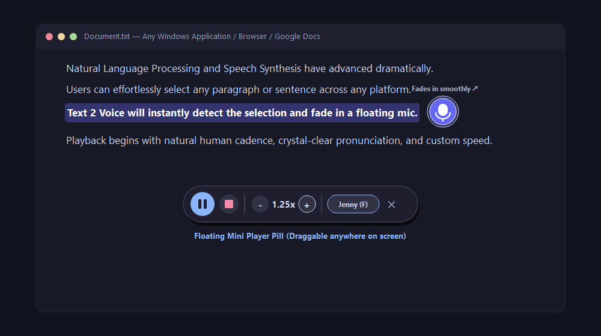

# Voxel (v1.2) - 2026-10-30

<p align="center">
  
</p>

<p align="center">
  <strong>Listen to what you read. Your way.</strong><br>
  A free, open-source desktop reader for selected text, documents and everyday reading.
</p>

<p align="center">
  <a href="https://github.com/Digimo2020/Voxel-/releases"></a>
  <a href="LICENSE"></a>
  <a href="https://github.com/Digimo2020/Voxel-/releases"></a>
</p>

---

## Why Voxel exists

I made Voxel because I wanted a simpler way to listen to the text I already have on my screen.

When we ask an AI assistant to explain something, the answer can be long. Asking the AI to read that answer aloud can use extra AI voice or conversation resources. I wanted a separate reader that could use available speech voices on my computer instead.

But this idea is about more than saving tokens.

I have dyslexia, so I understand that reading a long page is not always easy. Sometimes listening makes information easier to follow. Voxel is also for people who:
- find long blocks of text tiring or difficult to read;
- have dyslexia or other reading difficulties;
- prefer listening while working or resting;
- are learning English or another language that is not their first language;
- want to follow documents, articles, messages or study material by ear.

And yes, it's also for friends who would simply rather press Play than read a long page.

**The goal is simple: make information easier to access, in the way that works best for each person.**

## What makes Voxel different?

Many text-to-speech tools offer a voice and a Play button. Voxel aims to give listeners more control over the experience.

- **Voice choice** — choose from the voices currently included in the app.
- **Speaking speed** — adjust playback from 0.5× to 2.0× using the available presets.
- **Voice expression** — select a tone such as Expressive, Warm, Cheerful or Professional.
- **Read selected text** — highlight text in another app and use Voxel's floating control.
- **Read documents** — use the document action or open a supported file.
- **Compact floating player** — play, pause, resume and control reading without a large window.
- **Keyboard shortcuts** — start reading without searching through menus.
- **Free and open source** — inspect the code, make a fork or build your own version.

*Voice availability and expression options depend on the speech engine and the voice being used.*

## See Voxel

The images below are the existing repository UI previews and design assets. They are included as design references, not claimed to be fresh screenshots captured in this update. Replace them with verified captures from the current app when a Windows or macOS desktop test machine is available.

<p align="center">
  
</p>
<p align="center"><em>Floating controls and compact playback concept.</em></p>

<p align="center">
  
</p>
<p align="center"><em>Player appearance options.</em></p>

## How to use it

1. Install and open Voxel.
2. Select text in an app or browser.
3. Use the Voxel floating control to start reading the selection.
4. Use the compact player to pause or resume.
5. Open Settings to choose a voice, speed and expression style.

You can also use the document-reading action or open a supported file from Voxel.

### Keyboard shortcuts

| Action | Windows | macOS |
| --- | --- | --- |
| Read selected text | Ctrl + Alt + S | Command + Option + S |
| Read active document | Ctrl + Alt + D | Command + Option + D |

Shortcuts may be affected by another app using the same key combination.

## Download Voxel

**The current documented release is v1.1.04.** Check the Releases page for the available installers and the latest release notes.

<p align="center">
  <a href="https://github.com/Digimo2020/Voxel-/releases/latest"><strong>Download Voxel from GitHub Releases →</strong></a>
</p>

| Platform | Package | Notes |
| --- | --- | --- |
| Windows 10 / 11 | `.exe` | Standalone application |
| macOS | `.dmg` or `.pkg` | Follow the included macOS installation instructions |

The project is not currently presented as a signed Microsoft Store or Apple App Store application. Your operating system may show a security warning when opening an unsigned build. Read the release notes and the repository's setup guidance before proceeding.

## Run from source

You can run Voxel from Python instead of downloading a packaged app.

### Windows

```powershell
git clone https://github.com/Digimo2020/Voxel-.git
cd Voxel-
python -m venv .venv
.\.venv\Scripts\Activate.ps1
python -m pip install --upgrade pip
pip install -r requirements.txt
python main.py
```

### macOS

```bash
git clone https://github.com/Digimo2020/Voxel-.git
cd Voxel-
python3 -m venv .venv
source .venv/bin/activate
python -m pip install --upgrade pip
pip install -r requirements.txt
python main.py
```

If you prefer the included launcher scripts, see `run.bat` on Windows or `run.sh` on macOS. macOS may ask you to grant Accessibility permission so Voxel can detect text selection across apps.

## Does it use AI tokens?

Voxel is a separate reader; it does not need to ask ChatGPT or another AI assistant to generate a spoken version of an answer. That means you can copy or select text from an AI response and listen to it with Voxel instead of requesting the AI assistant's own voice feature.

A few important details:
- Voxel's included neural voice path uses the Edge TTS service and needs an internet connection.
- The app also contains platform-native speech fallback paths, but voice quality and availability vary by operating system.
- “No AI chat tokens” does not mean every voice path is offline or that network services are never used.
- This repository does not promise that every supported voice is available in every language or region.

## Accessibility is part of the idea

Voxel is designed to offer another way to take in information. Listening can be helpful, but it is not a replacement for screen readers, specialist assistive technology, or individual accessibility needs.

I hope it can be useful to people with dyslexia, reading fatigue, language-learning needs, or anyone who understands information better when they hear it. Feedback from people who use these tools every day is welcome.

## What's next?

Voxel is still growing. Some directions I would love to explore with the community include:

- **More languages and voices**, including better support for different accents.
- **More listening controls**, so people can shape pace, clarity and expression.
- **On-screen words and subtitles**, so listeners can follow along while the voice speaks.
- **More visual ways to understand content**, beyond audio alone.
- **Community-built versions and extensions**, made for different needs and workflows.

These are ideas for future development, not features promised in the current release.

## Help make it better

Voxel is open source under the MIT License. You can:
- report a bug or suggest an improvement through GitHub Issues;
- contribute code, documentation, translations or accessibility feedback;
- fork the project and adapt it for your own needs;
- build your own application based on the project, while following the license.

Before opening a pull request, please read [CONTRIBUTING.md](CONTRIBUTING.md). For security concerns, see [SECURITY.md](SECURITY.md).

## A note from the creator

I didn't build Voxel because the world needed one more complicated tool. I built it because I wanted reading to feel less like a barrier.

Sometimes I want to listen instead of read. Sometimes I need to slow the voice down, change its tone, or hear the same information in a different way. I know that feeling personally, and I hope Voxel helps someone else too.

It's free. It's open source. And I want the community to help shape what it becomes.

---

**Made by [Digimo](https://www.digimo.pt/) · [GitHub Issues](https://github.com/Digimo2020/Voxel-/issues) · [Releases](https://github.com/Digimo2020/Voxel-/releases) · [MIT License](LICENSE)**
