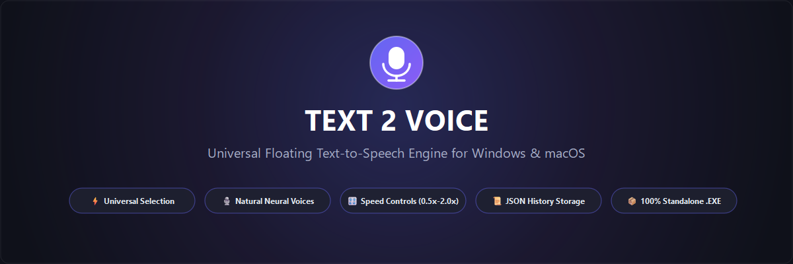
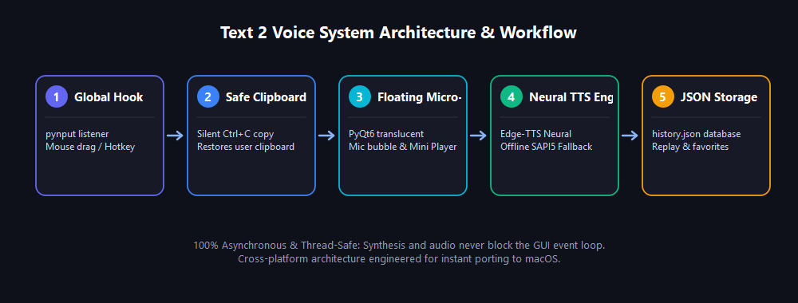

<p align="center">
  
</p>

<p align="center">
  <a href="LICENSE"></a>
  
  
  
</p>

<p align="center">
  <b>A lightweight, system-wide floating Text-to-Speech utility for Windows and macOS.</b><br>
  Highlight any word or sentence in <i>any</i> application — Chrome, Word, VS Code, Google Docs — and hear it spoken out loud with natural, human-like neural voices instantly.
</p>

---

## 📸 Preview

<p align="center">
  
</p>

1. **Highlight Text**: Select any text across any desktop or web application.
2. **Floating Mic Bubble**: A subtle circular mic icon smoothly fades in near your cursor.
3. **Mini Player Pill**: Click the mic to start listening, adjust speed (`0.5x`–`2.0x`), or switch voices.

---

## ⚡ Key Features

- **Universal Text Selection Detection**: Works seamlessly in native Windows apps, PDF readers, IDEs, and browser-based canvas editors like **Google Docs**.
- **Clipboard Preservation**: Silently captures highlighted text and immediately restores your clipboard history so your workflow is never interrupted.
- **Natural Human Neural Voices**: Uses high-clarity Microsoft Neural voices without requiring any cloud API keys:
  - ♀ **Jenny** (US English Female)
  - ♂ **Guy** (US English Male)
  - ♀ **Sonia** (UK English Female)
- **Automatic Offline Fallback**: Intelligently falls back to built-in system speech synthesis (Microsoft SAPI5 on Windows / NSSpeech on Mac) if you are offline.
- **Adjustable Speed Regulation**: Quick `-` and `+` buttons to step through `0.5x`, `0.75x`, `1.0x`, `1.25x`, `1.5x`, `1.75x`, and `2.0x`.
- **Draggable Floating Pill**: The mini player can be repositioned anywhere on your desktop by simply clicking and dragging.
- **Local JSON Database / History**: Spoken texts are automatically stored in `%LOCALAPPDATA%/Text2Voice/history.json` with timestamps, preview, voice, and speed. View and replay past clips via the **History Dialog**.
- **Global Hotkey**: Press <kbd>Ctrl</kbd> + <kbd>Alt</kbd> + <kbd>S</kbd> (or <kbd>Cmd</kbd> + <kbd>Alt</kbd> + <kbd>S</kbd> on Mac) on highlighted text to listen immediately without using the mouse.
- **System Tray Integration**: Sits discreetly in the Windows taskbar notification area. Right-click to toggle the selection popup, change default voices, view history, or quit.

---

## 🏛️ System Architecture

<p align="center">
  
</p>

The application operates completely asynchronously using multi-threaded worker queues. Speech synthesis and audio streaming never block the main Qt user interface event loop:

```
[ Active Application ] ───(Mouse Drag / Double Click)───> [ Selection Listener ]
                                                                 │
                                                    (Silent Ctrl+C & Restore)
                                                                 │
                                                       [ Clipboard Extractor ]
                                                                 │
                                                       [ Floating Mic Bubble ]
                                                                 │
                                                          (User Clicks Mic)
                                                                 │
                                    ┌────────────────────────────┴───────────────────────────┐
                                    ▼                                                        ▼
                        [ Neural TTS Worker ]                                      [ Floating Mini Player ]
                         (Edge-TTS / SAPI5)                                         (Play / Pause / Speed)
                                    │                                                        │
                                    ▼                                                        │
                            [ Audio Engine ] ◄───────────────────────────────────────────────┘
                             (Pygame Mixer)
                                    │
                                    ▼
                         [ Local JSON Database ]
                             (history.json)
```

---

## 🛠️ Technology Stack & Decisions

| Layer | Technology | Why It Was Chosen |
| :--- | :--- | :--- |
| **GUI Framework** | **PyQt6** | Native High-DPI support, frameless translucent windows, hardware-accelerated animations, ~35 MB RAM footprint (compared to ~150 MB for Electron). |
| **System Hooks** | **`pynput`** | Cross-platform global mouse and keyboard interception across Windows and macOS without external C++ compilation dependencies. |
| **TTS Engine** | **`edge-tts`** | Hyper-realistic Microsoft neural voices (free, no API key or subscription needed). |
| **Offline TTS** | **`pyttsx3` / SAPI5** | Automatic local fallback when offline. |
| **Audio Playback**| **`pygame.mixer`** | Zero-latency audio streaming with instant play, pause, resume, and stop controls. |
| **Storage** | **Local JSON (`history.json`)** | Ultra-lightweight persistent storage for speech history, favorites, and settings. |
| **Packaging** | **PyInstaller** | Bundles everything into a single, standalone `.exe` so end-users need zero dependencies. |

---

## 📂 Codebase Structure

```text
Text-2-Voice/
│
├── assets/
│   ├── icons.py              # Resolution-independent vector QPainter icons
│   └── screenshots/          # Repository banners, UI previews, and architecture diagrams
│
├── src/
│   ├── config.py             # Global constants, voice profiles, speed presets, color palettes
│   ├── tts_engine.py         # Multi-threaded TTS synthesis, rate calculation, audio playback
│   ├── selection_listener.py # Global mouse drag & double-click listener with collision detection
│   ├── ui/
│   │   ├── floating_bubble.py# Translucent circular floating mic button with cubic fade-in
│   │   ├── mini_player.py    # Draggable floating mini player pill with playback controls
│   │   ├── history_dialog.py # JSON speech history browser with replay and copy functionality
│   │   └── tray_icon.py      # Windows taskbar system tray icon and context menu
│   └── utils/
│       ├── clipboard.py      # Safe universal clipboard grabber & restoration
│       └── history.py        # JSON-based persistent storage manager
│
├── build_exe.bat             # 1-click standalone executable compiler
├── push_to_github.bat        # 1-click GitHub push helper
├── run.bat                   # 1-click Windows development runner
├── main.py                   # Main application entry point & event orchestrator
├── requirements.txt          # Python package dependencies
├── CONTRIBUTING.md           # Developer contribution guidelines
├── ROADMAP.md                # Future milestones (macOS port, multi-language, OCR)
├── LICENSE                   # MIT License
└── README.md                 # Project documentation
```

---

## 🚀 Quick Start

### 1. Download Standalone Executable (For Users)
No Python installation is required!
1. Go to the [Releases](https://github.com/Digimo2020/Text-2-Voice/releases) tab.
2. Download `Text2Voice.exe`.
3. Double-click to run. The app will launch into your system tray.

### 2. Run from Source (For Developers)
```bash
# Clone the repository
git clone https://github.com/Digimo2020/Text-2-Voice.git
cd Text-2-Voice

# Install dependencies
pip install -r requirements.txt

# Run the application
python main.py
```
*(Or simply double-click `run.bat` on Windows).*

### 3. Build Your Own `.exe`
Run the included build script:
```bat
build_exe.bat
```
The compiled binary will be placed inside `dist/Text2Voice.exe`.

---

## 🍎 macOS Porting Notes

The application uses 100% cross-platform libraries (`PyQt6`, `pynput`, `pyperclip`, `edge-tts`, `pygame`).

To run on macOS:
1. Ensure Python 3.10+ is installed (`brew install python`).
2. Run `pip install -r requirements.txt`.
3. Launch with `python3 main.py`.
4. macOS requires **Accessibility Permissions** to detect global mouse releases. When prompted, toggle Text 2 Voice on in **System Settings > Privacy & Security > Accessibility**.

---

## 📜 Local History JSON Format

Recent speech entries are stored automatically in `%LOCALAPPDATA%/Text2Voice/history.json`:

```json
[
  {
    "id": "t2v_1730132800123",
    "timestamp": "2026-10-28 16:30:15",
    "text": "Artificial intelligence is transforming how we interact with computers...",
    "preview": "Artificial intelligence is transforming how we...",
    "voice": "Jenny (Female)",
    "speed": 1.25,
    "char_count": 72
  }
]
```

---

## 🤝 Contributing

Contributions are warmly welcome! Please check out [**CONTRIBUTING.md**](CONTRIBUTING.md) for local development instructions, coding style, and PR guidelines.

To see what features are currently planned, see [**ROADMAP.md**](ROADMAP.md).

---

## 📄 License

This project is licensed under the **MIT License** — see the [LICENSE](LICENSE) file for details.
