# How to use Voxel

A picture-first guide. Every image below is a real Voxel window.

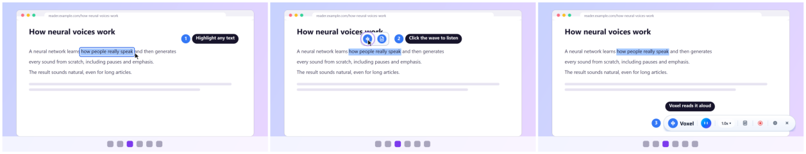

---

## 1. Install

| Windows | macOS |
| :--- | :--- |
| Download `Voxel-v<version>.exe` from [Releases](https://github.com/Digimo2020/Voxel-/releases/latest) and double-click it. | Download `Voxel-v<version>.dmg`, drag **Voxel** into *Applications*, then run `xattr -cr /Applications/Voxel.app` once in Terminal. |
| Windows blocks it ("Smart App Control")? Test builds are not code-signed yet. Run from source with `run.bat` instead. See [signing plan](WINDOWS_STORE_GUIDE.md). | Allow Voxel in *System Settings → Privacy & Security → Accessibility*, then restart it. |

Voxel lives in the **system tray** (Windows) or **menu bar** (macOS) after it starts.

---

## 2. Read selected text (the main way)

### Step 1: Highlight text in any app
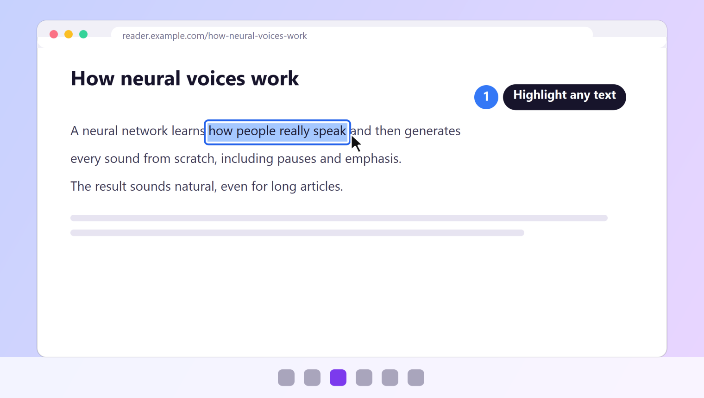

### Step 2: Click the wave icon on the bubble
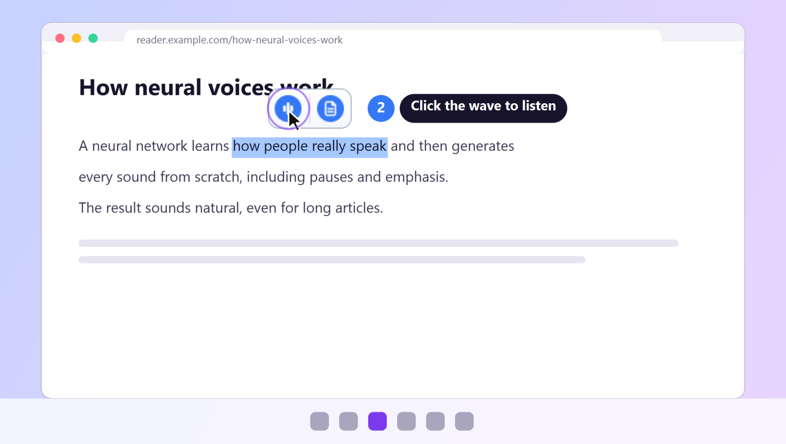

- **Wave icon** reads your selection. **Page icon** reads the whole document or PDF.
- Shortcuts: **Ctrl+Alt+S** reads the selection, **Ctrl+Alt+D** reads the whole document (macOS uses the same keys with Cmd+Option).

### Step 3: Listen
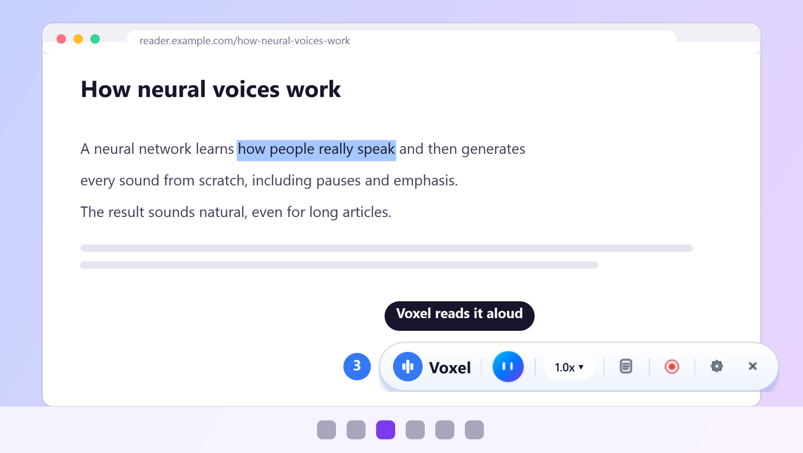

### The mini player

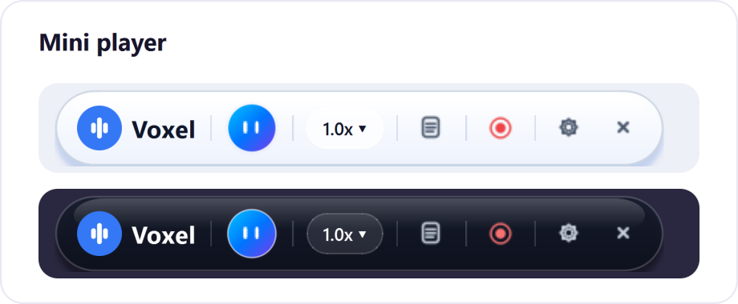

| Button | What it does |
| :--- | :--- |
| ⏯ Round blue button | Pause / resume |
| `1.0x ▾` | Change speed |
| 📄 Page icon | Read the entire document |
| ⏺ Red circle | Record the speech to an MP3 (saved in *Documents/Voxel Recordings*) |
| ⚙ Gear | Open Settings |
| ✕ | Close the player |

---

## 3. Read Text: for apps that block selection

Some apps and websites do not let Voxel read a selection. Copy the text yourself and use **Read Text**.

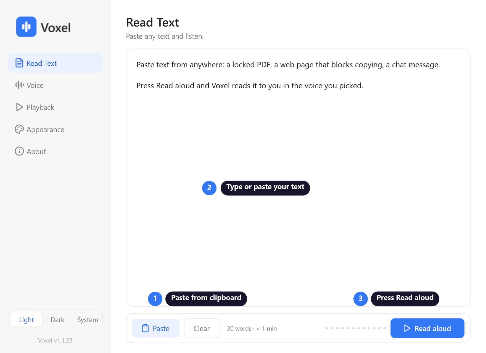

1. **Paste** from the clipboard (or type).
2. Check the text. The window shows word count and how long it will take.
3. **Read aloud**. Press it again to stop. Shortcut: **Ctrl+Enter**.

Open it any time: right-click the tray icon → **Read Text...**

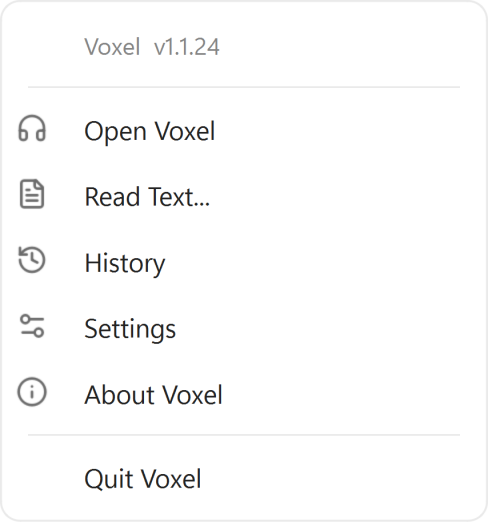

---

## 4. Make it yours (Settings)

Open Settings from the tray menu or the gear on the player. Change things, then press **Save changes**. Light and Dark are switched at the bottom of the sidebar.

### Voice: pick the voice, tone, speed, pitch and equalizer
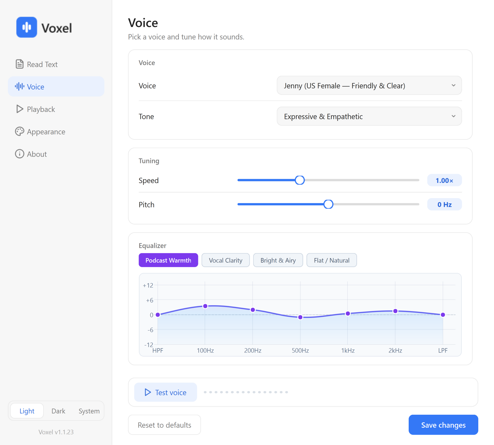

### Playback: what happens when you select text
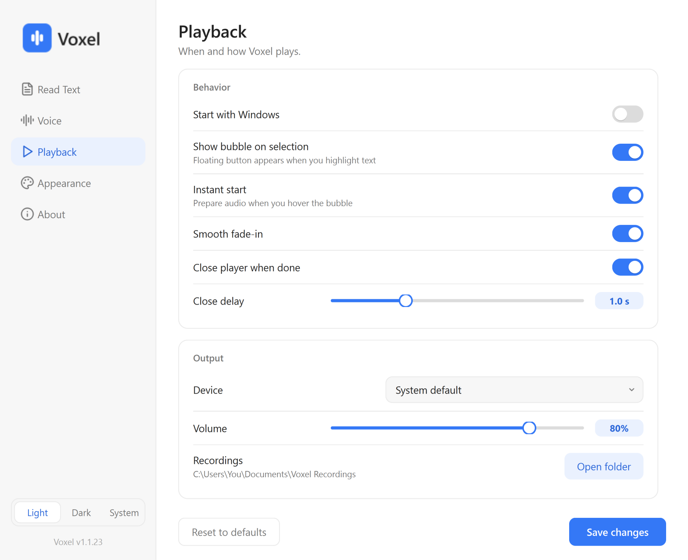

### Appearance: bubble style, size, corners, opacity
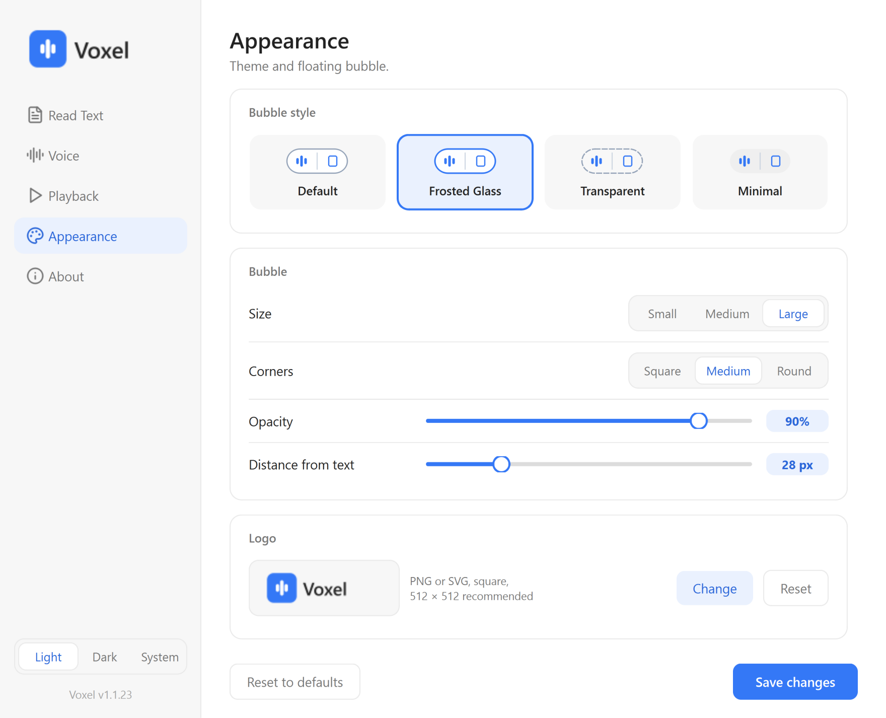

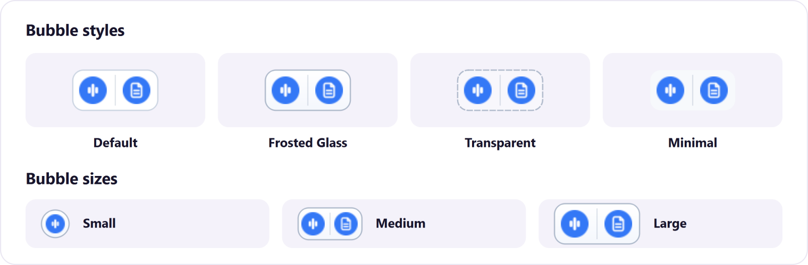

### Dark theme

  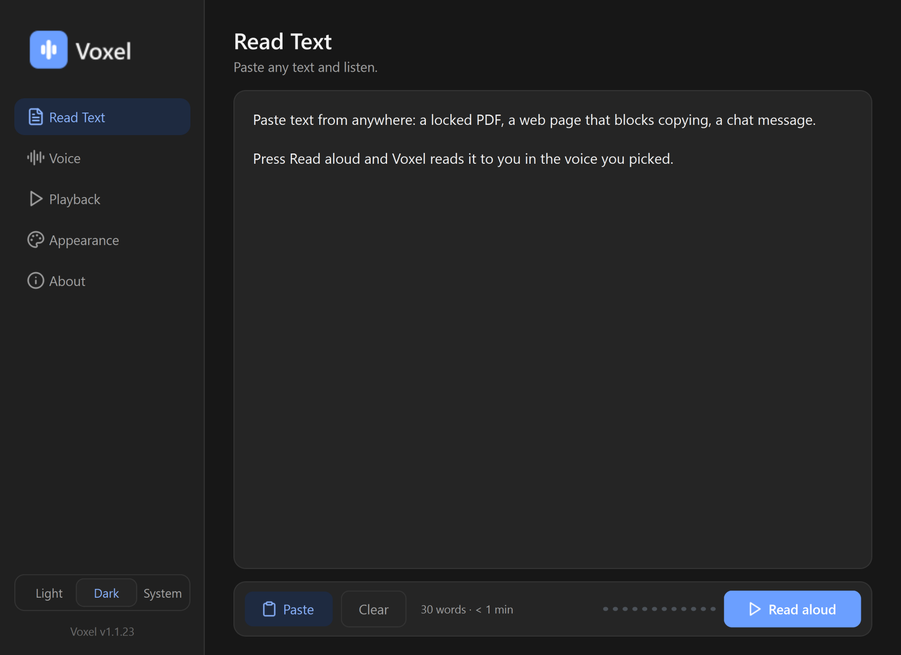
  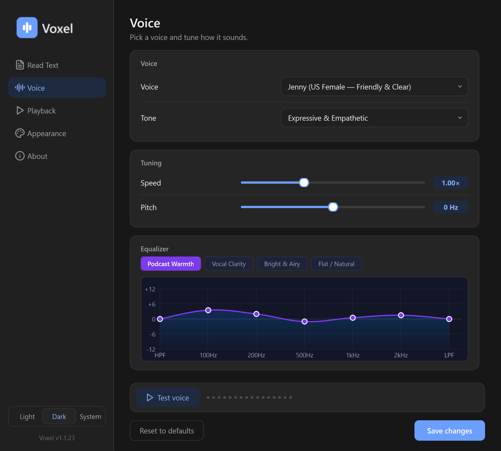

---

## 5. Problems?

| Problem | Try this |
| :--- | :--- |
| No bubble appears when I highlight text | Settings → Playback → turn on **Show bubble on selection**. On macOS check Accessibility permission. |
| App or website does not allow selecting | Use **Read Text** (section 3). |
| Windows says "blocked an app" | Not signed yet. Run `run.bat`, or see the [signing plan](WINDOWS_STORE_GUIDE.md). |
| No sound | Settings → Playback → **Volume** and **Device**. |
| Which version do I have? | Bottom of the Settings sidebar, for example `Voxel v1.1.23`. |

Still stuck? [Open an issue](https://github.com/Digimo2020/Voxel-/issues). Privacy: [PRIVACY.md](PRIVACY.md).

---

Images are generated from the real app by <code>python scripts/generate_docs_images.py</code> (demo data only).
